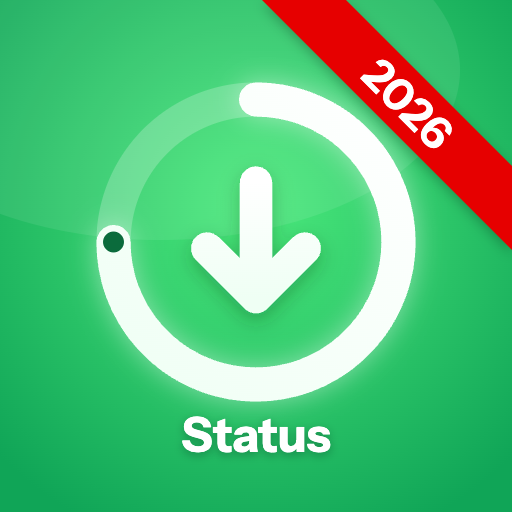
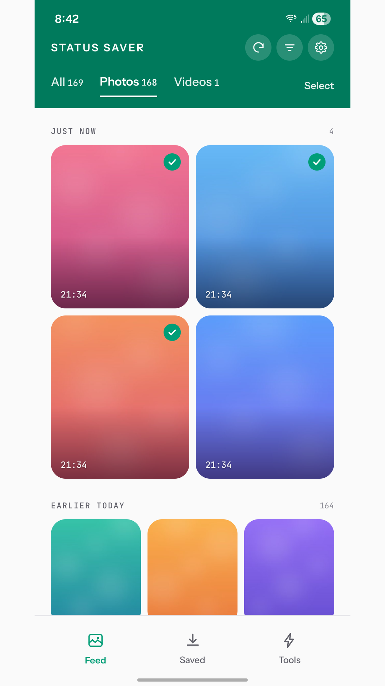
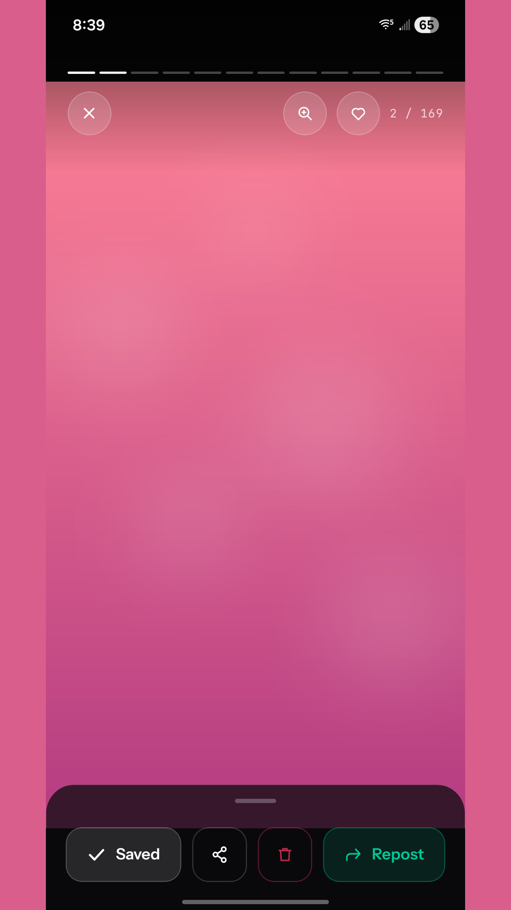
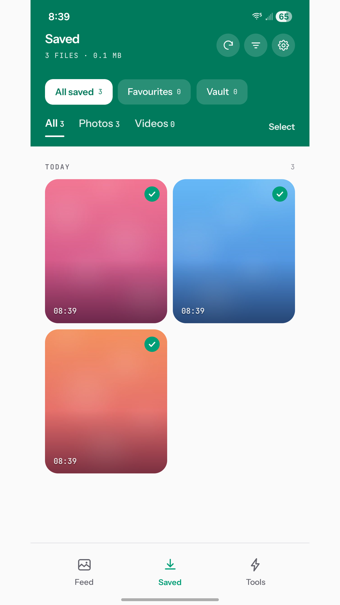
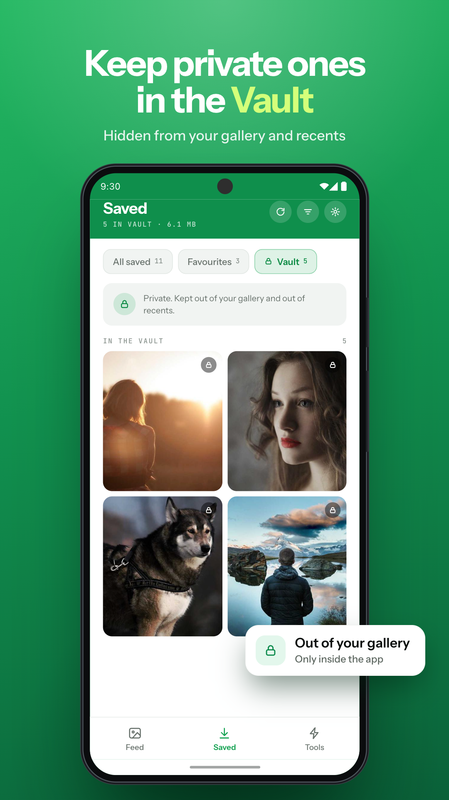
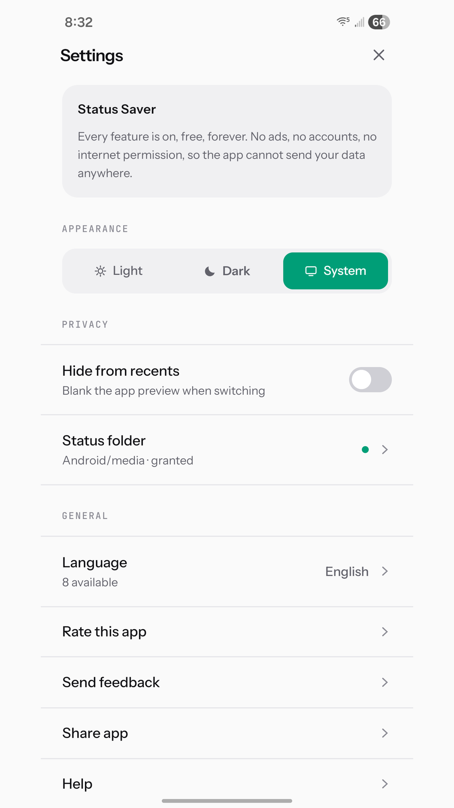

<div align="center">



# Status Saver

**View, save and share statuses, fully offline.**

No account, no ads, no trackers, no internet permission. Everything happens on your phone.

[](https://f-droid.org/packages/com.vaishnavmandlik.librestatus/)
[](https://github.com/vaishnav-mandlik/LibreStatus/releases/latest)
[](https://github.com/vaishnav-mandlik/LibreStatus/releases)
[](LICENSE)

</div>

---

## Download

<div align="center">

<a href="https://f-droid.org/packages/com.vaishnavmandlik.librestatus/">
  
</a>
<a href="https://github.com/vaishnav-mandlik/LibreStatus/releases/latest">
  
</a>

</div>

- **F-Droid:** [f-droid.org/packages/com.vaishnavmandlik.librestatus](https://f-droid.org/packages/com.vaishnavmandlik.librestatus/)
- **Google Play:** the same app, published as `com.mandlik.statussaverpro`
- **Direct APK:** the [releases page](https://github.com/vaishnav-mandlik/LibreStatus/releases/latest)

This repository is the single source for both stores. The F-Droid and Play
builds run the same code; they differ only in their application id (see
[Store flavors](#store-flavors)). The app was called LibreStatus before 1.1.0.

> A messaging app deletes the statuses you have viewed after 24 hours. Status
> Saver lists the ones already cached on your phone and lets you keep the ones
> you like.

## Screenshots

<div align="center">

| Feed | Viewer | Saved | Tools | Settings |
| :---: | :---: | :---: | :---: | :---: |
|  |  |  |  |  |

</div>

## Features

- All viewed statuses in one place, photos and videos together, sorted by time
- Save one status or many at once, straight to your gallery (`DCIM/Status`)
- Auto-save: keep every new status automatically when you open the app
- Built-in photo viewer and video player
- Repost a status or share it to any app
- Favourites to find the ones you love quickly
- Vault: move a saved status out of your gallery into the app's private storage
- Open a chat with any number without saving it to your contacts
- Light and dark theme, 8 languages
- Works on Android 7 and later

## How it works

1. Open your messaging app and view the statuses you like.
2. Open Status Saver and choose the `Android/media` folder once, when asked.
3. Every status you viewed appears here. Tap Save to keep it in your gallery.

## Privacy

- No `INTERNET` permission, so the app cannot send your data anywhere.
- No analytics, no advertising ID, no crash reporting, no account.
- On Android 11 and later it asks for no storage or media permission at all:
  the status folder is read through a grant you make in Android's own folder
  picker, and the gallery album only holds copies the app wrote itself. On
  Android 10 and below the storage permission stands in for both.
- Never asks for "All files access".

The full policy is in [PRIVACY.md](PRIVACY.md) and inside the app.

## Building from source

Requirements: Node 20+, JDK 17 and the Android SDK.

```sh
npm ci
npx tsc --noEmit                  # types
npx eslint . --ext .ts,.tsx       # lint
npx jest                          # tests

npm run android                   # run on a device or emulator
npm run build:android:fdroid      # F-Droid flavor, one APK per ABI
```

### Store flavors

| Flavor | Application id | Built by |
|---|---|---|
| `fdroid` | `com.vaishnavmandlik.librestatus` | F-Droid, from source, signed by F-Droid |
| `play` | `com.mandlik.statussaverpro` | the maintainer, signed with the Play upload key |

A store ties an app to its id forever, so each keeps the id it was published
under. Nothing else differs; the only runtime check is which store the "Share
app" link points to.

`assembleFdroidRelease` needs no keystore. The Play tasks
(`bundlePlayRelease`, `assemblePlayRelease`) refuse to run without
`android/keystore.properties`, which is never committed here.

### Releasing

1. Bump `versionCode` and `versionName` in `android/app/build.gradle`.
2. Add `fastlane/metadata/android/en-US/changelogs/<versionCode>.txt`.
3. Commit, tag (`git tag -a 1.2.0 -m 1.2.0`), push the tag. F-Droid picks the
   tag up on its own; see [fdroid/README.md](fdroid/README.md).
4. Build `bundlePlayRelease` with the upload key and upload it to Play.

## Tech

React Native 0.82 (new architecture, Hermes), TypeScript. Folder access on
Android 11+ goes through a small native module using the Storage Access
Framework.

## Contributing

Issues and pull requests are welcome. Please keep changes focused and run the
checks above before opening a PR.

## License

[MIT](LICENSE) © Vaishnav Mandlik

## Disclaimer

Status Saver is an independent app. It is not affiliated with, endorsed by, or
connected to WhatsApp or Meta. WhatsApp is a trademark of its respective owner.
Please respect other people's privacy and content rights when saving and
sharing statuses.
